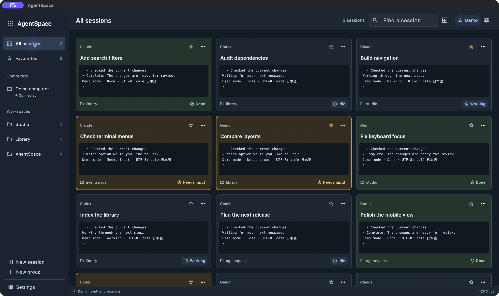
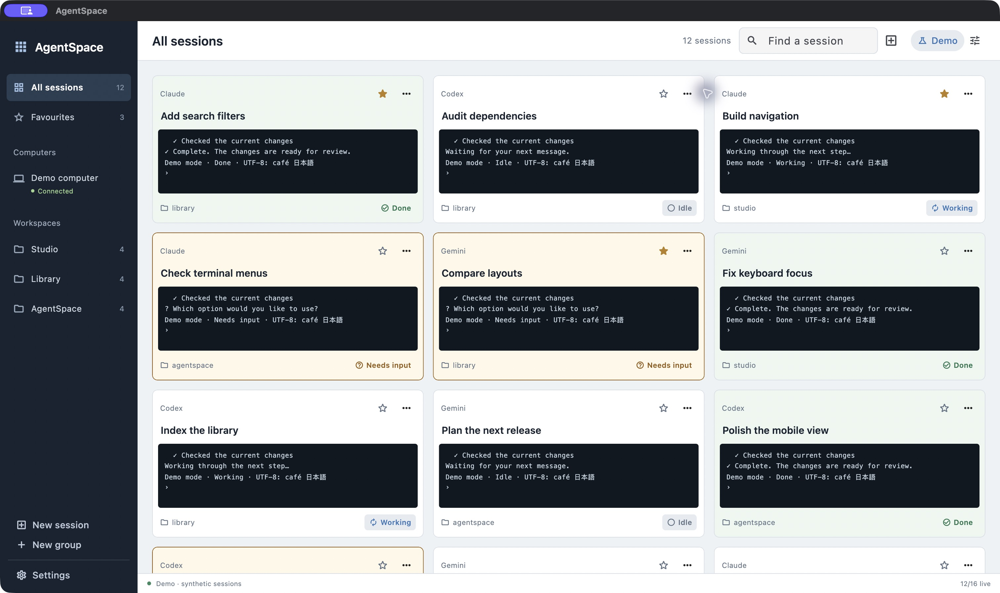
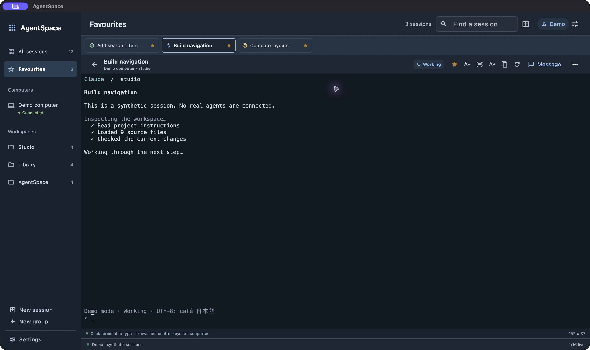

# AgentSpace

A Flutter workspace for Herdr sessions: live previews, Favourites, named groups, searchable workspaces, terminal tabs, direct keyboard input and a separate text + Enter composer.

macOS is the first release. Android uses the same adaptive interface and remote SSH connection. iPhone and iPad source is included and has been built and exercised in native iOS simulators through Xcode. Device installation requires your Apple development team. Windows/Linux packaging and detachable windows are deferred.

Drag favourites to reorder them in either the grid or the horizontal strip above an open terminal. Mouse and trackpad drags start immediately; on touch, press and hold first. Both views share the saved order and scroll when you drag near an edge.

Choose **Recent** in the sidebar to return to sessions you have opened, newest first, with their computer and workspace shown on each tile. The last 256 opened sessions are remembered per connection across launches. Background updates do not change this order, and sessions no longer in the current catalog are omitted. Recent always uses opening order; other views keep their saved sort and custom order.

Scroll the open terminal with two fingers on a trackpad, a mouse wheel or a vertical touch gesture. Supported attached connections forward scrolling to Herdr, including its application-specific scroll handling; gestures do not become typed arrows or commands. Wheel events are preserved when batched, including Claude’s mouse reporting. Click terminal controls such as **Jump to bottom** directly.

Use **Sort sessions** in the grid toolbar to choose Custom order, Name, Recently opened, Status, Computer or Workspace. The choice is saved for each connection. Status puts Needs input first, then Working, Done, Idle and Unknown; Recently opened tracks sessions opened in AgentSpace. In Custom order, drag tiles to reorder any grid; on touch, press and hold before dragging. Filtered views preserve the positions of hidden sessions. Dragging favourites switches the grid back to Custom order.

Opening or switching a session focuses its terminal for immediate typing. Brief app switches retain the connection; after longer background periods, AgentSpace reconnects while keeping the cached view, selection, search and drafts visible. The operating system may still suspend network connections in the background.

## Screenshots

Captured on macOS using the built-in Demo source. All session names, workspaces and terminal output shown here are synthetic.

**Session grid · dark mode**



**Session grid · light mode**



**Open terminal · favourites**



## Start

Build AgentSpace using the instructions below, then open the built app. The first launch opens **Demo**, with synthetic sessions. Star a session, then choose **Favourites**. Click a tile to open its terminal; the back arrow returns to the overview. Settings contains connections, preview density, terminal text scale and **Appearance → System / Light / Dark**. Your appearance choice is saved across launches; System follows the device setting.

On a phone, tap the menu icon or workspace title to open the sidebar. Choose All sessions, Favourites, a saved computer, a workspace or one of your groups. Search takes over the top bar with a wide field; the × button cancels search, clears its filter and restores navigation.

For local sessions, choose **Settings → Local Mac → Connect**. Herdr must already be running. AgentSpace uses its bundled Mac helper and your installed Herdr CLI; the main app remains sandboxed. No fixed socket exception or folder-access grant is needed. For a custom installation, edit **Herdr executable** and **Server socket** before connecting. New profiles discover standard CLI locations automatically. macOS **13 or newer** is required for the helper’s connection authentication. See [local integration](docs/local-integration.md).

On Android, build and install the APK, then add an SSH connection. Ordinary passwords and SSH keys work with Herdr running on the computer; a dedicated restricted key is optional. See [remote setup](docs/remote-setup.md). iPhone/iPad use the same remote connection. The iOS identifier is **io.novaware.agentspace**, choose your own Apple development team and a bundle identifier available to that team when building for a physical device.

## Use

- Right-click a session tile, or use its three-dot menu on touch, for **Rename** and **Close terminal…**. Rename changes Herdr’s pane title. Close asks for confirmation and ends that actual terminal and its running process; it leaves a saved favourite as an unavailable bookmark.
- Choose **New session** in the toolbar or sidebar, select a computer and an existing Herdr workspace, and optionally enter a title and folder (`/…` or `~/…`). Leave the folder empty for Herdr’s default. AgentSpace creates a shell terminal; type your agent’s start command there.
- Session actions require a connected, writable computer with management support. An uncertain action stops further management on that computer until you inspect its sessions and choose **I’ve checked** from **Check unconfirmed session action**. Typing has its own independent delivery checks. Actions are never automatically retried.

- Stars create a persistent Favourites collection. Offline favourites retain their names and become unavailable placeholders.
- The Computers section lists the gateway and its directly saved Herdr computers, with per-computer connection status. All sessions combines their catalogs; computer filters narrow the view. Matching workspace names are qualified by computer, and session cards identify their computer. Search also matches computer and named-session labels. The sidebar groups sessions by Herdr workspace. Create named groups and move sessions through the session menu or drag a tile onto a group. Drag tabs to reorder them.
- Green **Done**, amber **Needs input** and neutral **Idle** describe the agent. Connection problems are shown separately.
- Zoom changes font size and the selected terminal’s rows/columns to fit the available area, so the running app can reflow its text. Window resizing and showing/hiding Message also update that grid. **Fit** resets text size. This uses Herdr viewport control and affects the same terminal in Herdr; an existing controller is never forcibly replaced. Read-only connections and older remote gates keep the observation view. Scroll and copy remain available.
- On Mac, drop up to four PNG/JPEG/GIF/WebP/BMP image files from Finder onto an open terminal (16 MiB each). Images are copied to the computer hosting that pane and their paths are added to the current prompt; press Enter yourself when ready. Upload progress overlays the terminal. Cancel stops a transfer; Retry resumes at a failed image without duplicating earlier attachments. Temporary destination copies expire after 24 hours. Ordinary SSH and the bundled Mac helper support this; legacy/restricted connections do not.
- Click or tap a live terminal to type directly. Arrows, Enter, Tab, function keys and Ctrl/Alt/Shift combinations go to that session in order. Command-modified Delete, arrows, Home and End also reach Herdr. On macOS, Cmd+Backspace sends Ctrl+U to clear back to the start of the line. Ctrl+Enter goes to the terminal while it has focus. The message box starts hidden; use **Message** in the terminal toolbar to show or hide it without losing your draft. It supports longer drafts and system dictation; **Send text + Enter** submits its reviewed text. Multi-line paste opens in the message box and preserves an existing draft; paste that would exceed 16 KiB is rejected with a notice. Unsupported keyboard chords show one status-line notice without moving the terminal.
- If delivery is uncertain or the keyboard queue cannot keep up, further input stops and the warning survives relaunch. Check the terminal, then choose **I’ve checked** before typing or sending again. Nothing is automatically replayed.
- Layouts and drafts save separately for each connection. Closing or backgrounding the app releases observations without stopping agents.

macOS shortcuts: ⌘1 Favourites, ⌘0 all sessions, ⌘F search, Esc overview, ⌘R reconnect, ⌘Enter send draft. Ctrl+F and Ctrl+Enter send to the focused terminal; from the message box, Ctrl+Enter sends its draft. ⌘Enter retains the draft shortcut. Escape goes to a focused terminal and returns to the overview outside it. On non-Mac keyboards, Ctrl+Shift+C/V copy and paste.

## Saved computers and persistent connections

Ordinary SSH uploads a small versioned helper once to each participating account, then reuses separate workers for discovery, typing, previews and image transfers. The image worker starts only when needed. The gateway reaches saved computers using its existing OpenSSH setup; their credentials stay there. Peers need working Python 3.9 or newer and a compatible running Herdr. Ordinary SSH probes the interpreter on PATH, then existing account-local, Homebrew, standard /usr/local and MacPorts locations; a broken Apple Python launcher does not hide a working installation. A peer that needs setup or SSH access stays visible without disconnecting other sessions. Discovery is one hop; disabled machines are shown but not contacted. See [bridge behavior and protocol](docs/bridge-protocol.md) for cache paths, routing, restrictions and verification.

## Build with FVM

Flutter **3.47.7** is pinned in .fvmrc; dependencies are locked in pubspec.lock.

```sh
fvm install
fvm flutter pub get
fvm flutter test
fvm flutter analyze
fvm flutter build macos --release
scripts/sign-macos
fvm flutter build apk --debug
fvm flutter build ios --release --no-codesign
```

The scripts/flutterw and scripts/dartw wrappers use FVM and keep tool caches local. If Xcode rejects a valid workspace in a restricted execution environment, scripts/build-macos builds the prepared CocoaPods and Runner projects separately. It expects generated Flutter configuration and installed pods from the standard build preparation.

The default Mac build is for local testing, ad-hoc signed and not notarized. The helper is signed separately and exposes only allowlisted Herdr operations. For Developer ID signing, scripts/sign-macos accepts AGENTSPACE_SIGNING_IDENTITY and keeps Hardened Runtime; notarization is a separate release step. The default Android release configuration uses a development signing key; it is a test package, not a store release. No production signing keys are included. The iOS project requires your chosen signing team before device installation.

## Verification

Run the optional transport checks against disposable servers only:

```sh
python3 -m venv .tool-cache/test-ssh
.tool-cache/test-ssh/bin/pip install -r test/requirements.txt
AGENTSPACE_TEST_PYTHON="$PWD/.tool-cache/test-ssh/bin/python" HERDR_TEST_BINARY="$HOME/.local/bin/herdr" scripts/flutterw test
python3 -m unittest discover -s scripts -p 'test_*.py'
```

The installed Herdr test uses a temporary UNIX socket; it does not connect to live sessions. See [testing](docs/testing.md) for checks and testing boundaries.

## License

[MIT](LICENSE). See [third-party notices](THIRD_PARTY_NOTICES.md) for vendored dependencies.
